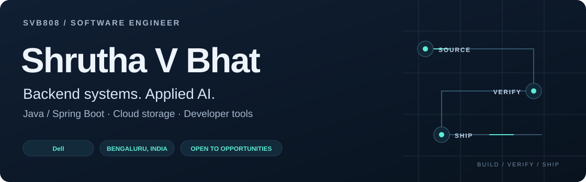

  <a href="https://github.com/SVB808/changeguard">ChangeGuard</a> &nbsp;·&nbsp;
  <a href="https://github.com/SVB808/openai-decisions-api-benchmark">API experiments</a> &nbsp;·&nbsp;
  <a href="https://github.com/SVB808/flowpet-desktop">Desktop apps</a> &nbsp;·&nbsp;
  <a href="https://github.com/hiero-ledger/hiero-sdk-java/pull/3042">Open source</a>

I'm <strong>Shrutha</strong>, a software engineer based in <strong>Bengaluru, India</strong>, previously at <strong>Dell Technologies</strong>. My work spans Java/Spring services, cloud storage integrations, test automation, and AI tools for developers.

<h2>Selected work</h2>

<table>
  <tr>
    <td width="50%" valign="top">
      <h3><a href="https://github.com/SVB808/changeguard">01 · ChangeGuard</a></h3>
      
<strong>What could a Spring change break downstream?</strong>

      
Connects Java/Spring changes to affected services and consumer calls. Produces verification plans tied to the analyzed commit and reports grounded in collected evidence.

      
<code>Python</code> <code>Java</code> <code>LangGraph</code> <code>Ollama</code>

      
<a href="https://github.com/SVB808/changeguard">Code</a> · <a href="https://github.com/SVB808/changeguard/blob/main/docs/demo.md">Reproducible demo</a> · <a href="https://github.com/SVB808/changeguard#evaluation">Evaluation</a>

      
Release candidate · Java/Spring analysis

    </td>
    <td width="50%" valign="top">
      <h3><a href="https://github.com/SVB808/openai-decisions-api-benchmark">02 · API workflow benchmark</a></h3>
      
<strong>Measure latency, accuracy, and error patterns.</strong>

      
Compares OpenAI Decisions and Responses classification workflows. Includes published measurements, an experiment report, and explicit limits on what the results establish.

      
<code>Python</code> <code>API evaluation</code> <code>Data analysis</code>

      
<a href="https://github.com/SVB808/openai-decisions-api-benchmark">Code</a> · <a href="https://github.com/SVB808/openai-decisions-api-benchmark/blob/main/extended_report.md">Results</a> · <a href="https://github.com/SVB808/openai-decisions-api-benchmark/blob/main/extended_results.csv">Raw data</a>

      
Exploratory benchmark · 200 message strings, 40 underlying scenarios

    </td>
  </tr>
  <tr>
    <td colspan="2" valign="top">
      <h3><a href="https://github.com/SVB808/flowpet-desktop">03 · Desktop focus companion</a></h3>
      
A Windows desktop project combining foreground-app context, local history, optional local-model classification, and a companion interface to help users return to their intended work.

      
<code>Rust</code> <code>Tauri</code> <code>React</code> <code>TypeScript</code> <code>SQLite</code>

      
<a href="https://github.com/SVB808/flowpet-desktop">Code</a> · <a href="https://github.com/SVB808/flowpet-desktop/blob/main/docs/architecture.md">Architecture</a>

      
In development · Repository working title: FlowPet

    </td>
  </tr>
</table>

<h2>Open source</h2>

<strong>Hiero Java SDK</strong> — <a href="https://github.com/hiero-ledger/hiero-sdk-java/pull/3042">merged pull request #3042</a>, correcting <code>TopicUpdateTransaction</code> Javadoc references. The PR documents Javadoc generation and targeted test validation.

<h2>Tools I work with</h2>

<ul>
  <li><strong>Backend:</strong> Java, Spring Boot, REST APIs, Python</li>
  <li><strong>Data &amp; infrastructure:</strong> PostgreSQL, AWS S3/IAM/STS SDKs, Docker, Jenkins</li>
  <li><strong>Applied AI:</strong> LangGraph, LangChain4j, Spring AI, RAG, MCP, Ollama</li>
  <li><strong>Web:</strong> TypeScript, React, Angular</li>
</ul>

<strong>Interested in backend and applied AI engineering opportunities.</strong> Bengaluru · Remote from India

