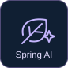
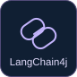
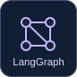
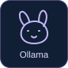
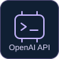
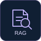
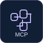
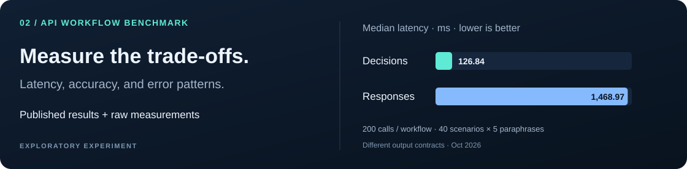
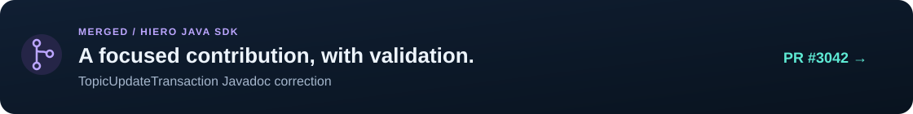

<picture>
  <source media="(max-width: 600px) and (prefers-reduced-motion: reduce)" srcset="assets/profile-banner-mobile-static.svg" />
  <source media="(max-width: 600px)" srcset="assets/profile-banner-mobile.svg" />
  <source media="(prefers-reduced-motion: reduce)" srcset="assets/profile-banner-static.svg" />
  
</picture>

  
  &nbsp;
  

I build Java/Spring services, cloud storage integrations, and AI tools for developers. My work spans backend engineering, automation, and applications people use.

<strong>Engineering toolkit</strong>

  
  
  
  
  
  
  
  

<strong>Generative AI &amp; agents</strong>

  
  
  
  
  
  
  

## Selected work

<table width="100%">
<tr><td>
<h3>01 · ChangeGuard</h3>

<a href="https://github.com/SVB808/changeguard">
  <picture>
    <source media="(max-width: 600px)" srcset="assets/projects/changeguard-mobile.svg" />
    
  </picture>
</a>

Trace Spring API changes to downstream consumers, then plan verification against the exact analyzed commit.

<strong>TECH STACK</strong>

  
  
  
  

<strong>Explore:</strong> <a href="https://github.com/SVB808/changeguard">Code</a> · <a href="https://github.com/SVB808/changeguard/blob/main/docs/demo.md">Reproduce the demo</a> · <a href="https://github.com/SVB808/changeguard/tree/main/docs/decisions">Design decisions</a>

</td></tr>
</table>

 

<table width="100%">
<tr><td>
<h3>02 · API workflow benchmark</h3>

<a href="https://github.com/SVB808/openai-decisions-api-benchmark">
  <picture>
    <source media="(max-width: 600px)" srcset="assets/projects/benchmark.svg" />
    
  </picture>
</a>

An exploratory comparison of classification accuracy, latency, and error patterns, with published data and limitations.

<strong>TECH STACK</strong>

  
  
  

<strong>Explore:</strong> <a href="https://github.com/SVB808/openai-decisions-api-benchmark">Code</a> · <a href="https://github.com/SVB808/openai-decisions-api-benchmark/blob/main/extended_report.md">Results and methodology</a> · <a href="https://github.com/SVB808/openai-decisions-api-benchmark/blob/main/extended_results.csv">Raw measurements</a>

</td></tr>
</table>

 

<table width="100%">
<tr><td>
<h3>03 · Desktop focus companion</h3>

<a href="https://github.com/SVB808/flowpet-desktop">
  <picture>
    <source media="(max-width: 600px)" srcset="assets/projects/flowpet.svg" />
    
  </picture>
</a>

A Windows desktop companion that combines activity context, local history, and optional AI to help users return to their work.

<strong>TECH STACK</strong>

  
  
  
  
  

<strong>Optional AI:</strong> Ollama · OpenAI-compatible endpoints

<strong>Explore:</strong> <a href="https://github.com/SVB808/flowpet-desktop">Code</a> · <a href="https://github.com/SVB808/flowpet-desktop/blob/main/docs/architecture.md">Architecture</a> · <a href="https://github.com/SVB808/flowpet-desktop/blob/main/docs/roadmap.md">Development roadmap</a>

</td></tr>
</table>

 

## Open-source activity

<a href="https://github.com/hiero-ledger/hiero-sdk-java/pull/3042">
  <picture>
    <source media="(max-width: 600px)" srcset="assets/activity-mobile.svg" />
    
  </picture>
</a>

  
More of my toolkit

  
AWS S3/IAM/STS SDKs · Angular · JUnit · Mockito · Jenkins · Gradle · Maven

---

<strong>Open to backend and applied AI engineering opportunities.</strong> Bengaluru · Remote from India

