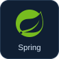
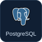
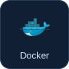
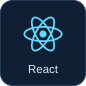
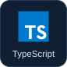
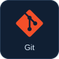
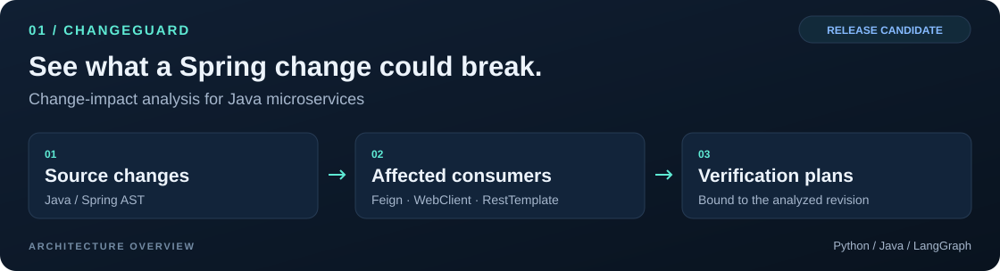
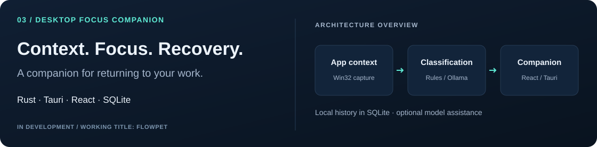

<picture>
  <source media="(max-width: 600px) and (prefers-reduced-motion: reduce)" srcset="assets/profile-banner-mobile-static.svg" />
  <source media="(max-width: 600px)" srcset="assets/profile-banner-mobile.svg" />
  <source media="(prefers-reduced-motion: reduce)" srcset="assets/profile-banner-static.svg" />
  
</picture>

  
  &nbsp;
  

I build Java/Spring services, cloud storage integrations, and AI tools for developers. My work spans backend engineering, automation, and applications people use.

  
  
  
  
  
  
  
  

## Selected work

<a href="https://github.com/SVB808/changeguard">
  <picture>
    <source media="(max-width: 600px)" srcset="assets/projects/changeguard-mobile.svg" />
    
  </picture>
</a>

Trace Spring API changes to downstream consumers, then plan verification against the exact analyzed commit.

**Python · Java · LangGraph · Ollama**  
[Code](https://github.com/SVB808/changeguard) · [Reproduce the demo](https://github.com/SVB808/changeguard/blob/main/docs/demo.md) · [Design decisions](https://github.com/SVB808/changeguard/tree/main/docs/decisions)

<a href="https://github.com/SVB808/openai-decisions-api-benchmark">
  <picture>
    <source media="(max-width: 600px)" srcset="assets/projects/benchmark.svg" />
    
  </picture>
</a>

An exploratory comparison of classification accuracy, latency, and error patterns, with published data and limitations.

**Python · API evaluation**  
[Code](https://github.com/SVB808/openai-decisions-api-benchmark) · [Results and methodology](https://github.com/SVB808/openai-decisions-api-benchmark/blob/main/extended_report.md) · [Raw measurements](https://github.com/SVB808/openai-decisions-api-benchmark/blob/main/extended_results.csv)

<a href="https://github.com/SVB808/flowpet-desktop">
  <picture>
    <source media="(max-width: 600px)" srcset="assets/projects/flowpet.svg" />
    
  </picture>
</a>

A Windows desktop companion that combines activity context, local history, and optional AI to help users return to their work.

**Rust · Tauri · React · TypeScript · SQLite**  
[Code](https://github.com/SVB808/flowpet-desktop) · [Architecture](https://github.com/SVB808/flowpet-desktop/blob/main/docs/architecture.md) · [Development roadmap](https://github.com/SVB808/flowpet-desktop/blob/main/docs/roadmap.md)

## Open-source activity

<a href="https://github.com/hiero-ledger/hiero-sdk-java/pull/3042">
  <picture>
    <source media="(max-width: 600px)" srcset="assets/activity-mobile.svg" />
    
  </picture>
</a>

  
More of my toolkit

  
LangChain4j · Spring AI · RAG · MCP · AWS S3/IAM/STS SDKs · Angular · JUnit · Mockito · Jenkins · Gradle · Maven

---

<strong>Open to backend and applied AI engineering opportunities.</strong> Bengaluru · Remote from India

